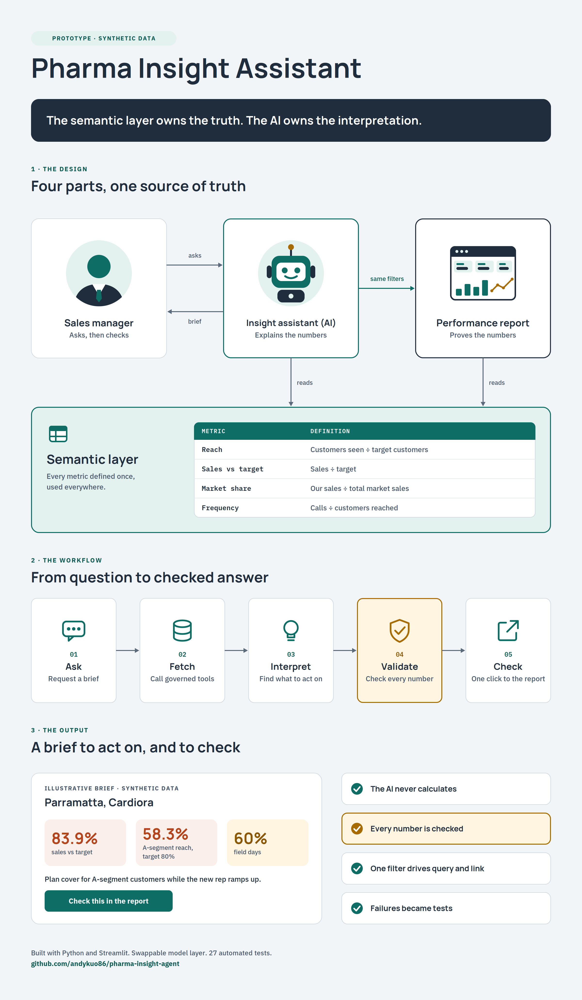

# Commercial insight assistant (prototype)

A working prototype of an AI assistant for pharma sales managers. It turns the
monthly performance report into a one-page brief of insights a manager can act on,
answers follow-up questions, and links every insight back to the standard report,
already filtered, so the manager can check the numbers and learn to read the report
themselves.

All data is synthetic. No real company, product, customer or sales data is used.

## The concept in one picture

<p align="center">
  
</p>

*Click the image to view it full size.*

## Design principles

1. **The semantic layer owns the truth; the AI owns the interpretation.**
   Metrics are calculated once, in `semantic_layer.py`, as they would be in a Power BI
   semantic model or Foundry ontology. The AI never recalculates a number.
2. **The report stays the source of truth.** The assistant and the report read from
   the same semantic layer, and one filter object drives both the data query and the
   report link. The numbers in the brief and in the report cannot differ.
3. **Every insight carries its evidence.** The numbers, the governed metric
   definition, and a link to the filtered report view.
4. **Build data literacy, not dependence.** The assistant sends people back to the
   report with a reason to look, and explains how to read what they see.

## How it works

```
Manager --> Insight assistant (Claude + tools) --> semantic_layer.py <-- Performance report
                 |                                                            ^
                 +--- every insight links to the report, already filtered ----+
```

- `semantic_layer.py` holds the governed measures: sales vs target and gap to target,
  market share and share change, reach and reach gap, frequency, field days and call
  rate, with status rules. It is the only place numbers are calculated.
- `views/report.py` is the mock standard report. It reads its filters from the URL,
  for example
  `http://localhost:8501/report?period=2026-09&territory=T03&product=Cardiora&segment=A&view=coverage`
- `assistant/tools.py` gives the model six tools. Each queries the semantic layer and
  returns the rows, the governed "how to read" text, and the report link for the same
  filters.
- `assistant/agent.py` runs the tool loop and writes the monthly brief. The system
  prompt forbids calculating numbers or writing links, and asks the model to judge
  results against targets and brand priority, and to explain metrics in plain English.
- `assistant/validation.py` checks every answer before it is shown: each number quoted
  must appear in the tool results, and each link must be one the tools generated.
  Anything that fails is flagged to the user.
- `assistant/llm.py` connects to the model. `AnthropicClient` covers Claude and
  `OpenAICompatibleClient` covers Gemini, Groq, OpenRouter or a company's own
  enterprise gateway. The rest of the app does not change when the provider does.
- `data/generate_data.py` creates the synthetic data: 18 ANZ territories, 3 brands
  (P1 Cardiora, P2 Neurava, P3 Dermalyn), A/B/C customer segments, 12 months.

Four scenarios are built into the data for the assistant to find:

| Territory | What is going on |
|---|---|
| T03 Parramatta | Cardiora off track after a rep vacancy cut field days and A-segment reach |
| T07 Melbourne South | Cardiora on target, but market share falling since a competitor launch |
| T16 Auckland Central | Field effort on the P3 brand while P1 A-segment reach is well below target |
| T13 Perth North | Strong performer, above target with high A-segment reach |

## Run it

```bash
python3 -m venv .venv && source .venv/bin/activate
pip install -r requirements.txt
export GEMINI_API_KEY="your-key"   # free key from Google AI Studio; the report works without any key
streamlit run app.py               # opens http://localhost:8501
pytest                             # 27 tests, no API key needed
```

## Choosing the model

The assistant works with any model that can call tools. Set one API key and it is
picked up automatically:

| Provider | Key | Default model | Notes |
|---|---|---|---|
| Google Gemini | `GEMINI_API_KEY` | gemini-3.8-flash | Free tier, key from Google AI Studio |
| Anthropic Claude | `ANTHROPIC_API_KEY` | claude-sonnet-5-5 | Paid, key from the Anthropic Console |
| Groq | `GROQ_API_KEY` | llama-3.3-70b-versatile | Free tier |
| OpenRouter | `OPENROUTER_API_KEY` | set `LLM_MODEL` | Some free models |

Set `LLM_MODEL` to use a different model, for example a newer Gemini Flash model
listed in Google AI Studio. Set `LLM_PROVIDER` if more than one key is present.

Model names change often. If the default model is retired, the error will say so;
set `LLM_MODEL` to a current one.

Free tiers may use what you send to improve their models. That is acceptable here
because the data is synthetic. Real company data belongs on an enterprise model
with appropriate data terms.

## Testing without a model

`tests/test_assistant.py` uses a scripted stand-in for the model that calls the real
tools against the real semantic layer. The tests prove that a correct brief passes
validation, an invented number is flagged, a link not generated by the tools is
flagged, and every tool link opens the report with the same filters.

## Next steps

- Run the assistant live on the four scenarios and review the briefs.
- Write the case study: problem, design, governance (validation, use-case register,
  rollback) and the adoption plan for field managers.
